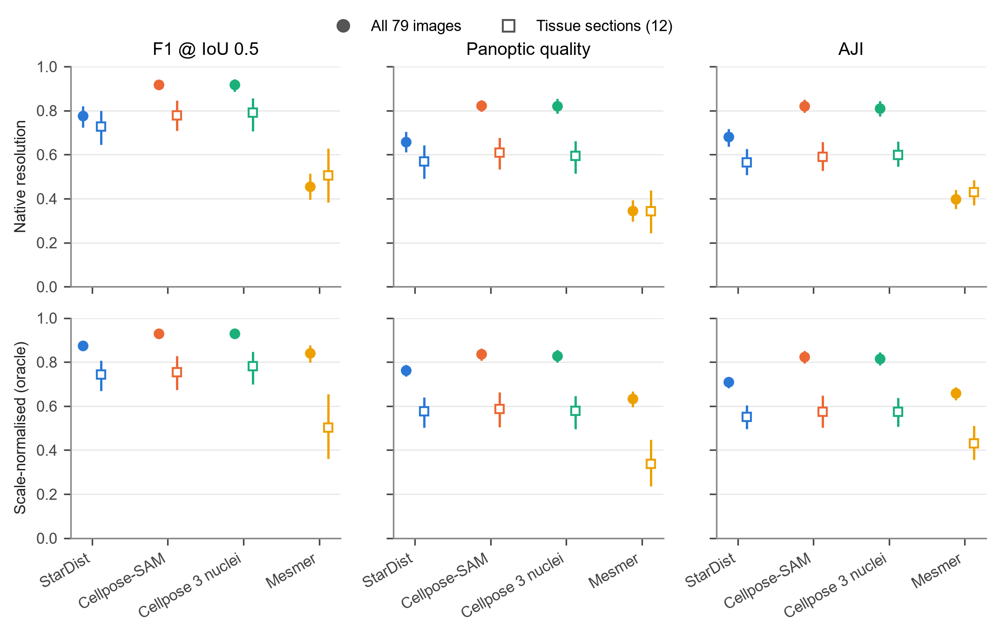
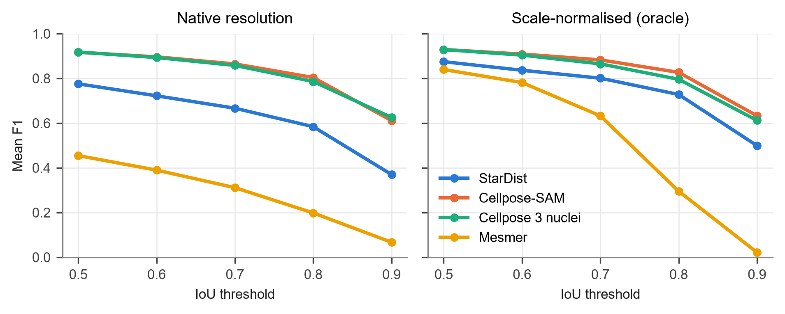
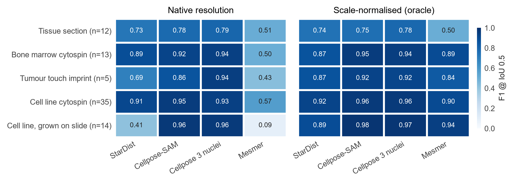
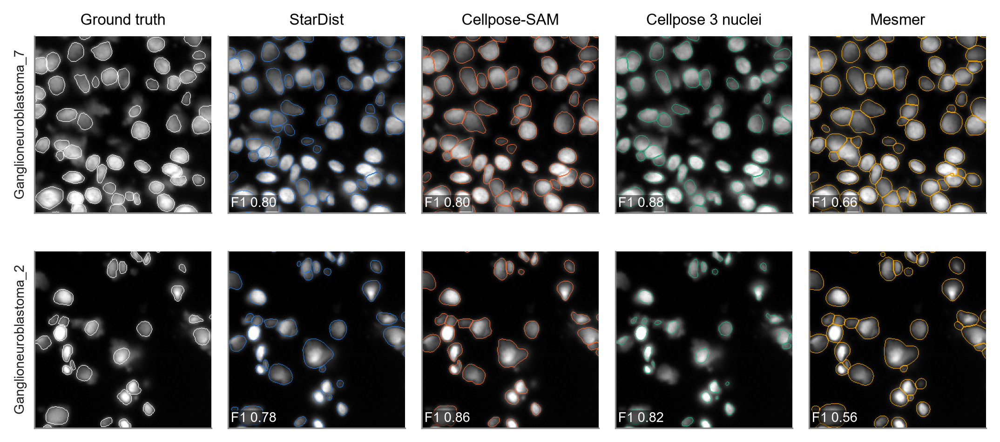
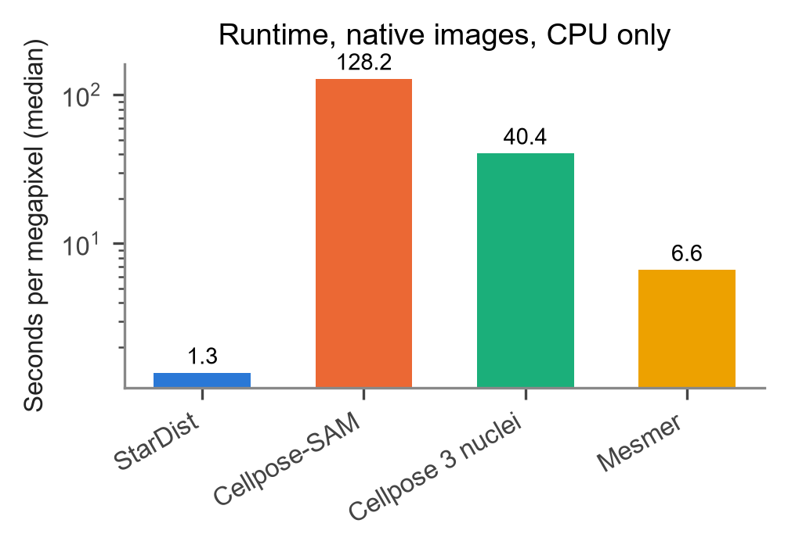

# Segmentation benchmark: StarDist, Cellpose and Mesmer on fluorescent nuclei

Most single-cell image analysis starts by finding nuclei, and every downstream measurement
inherits that step's errors. This repo compares four widely used nuclear segmentation tools,
run with default settings, against expert annotations.

## Headline

On 79 fluorescence images with 7,764 hand-annotated nuclei. F1 at IoU 0.5, mean with 95% CI:

| Tool | All images | Tissue sections (n=12) |
|---|---:|---:|
| Cellpose 3 nuclei | **0.918** [0.886, 0.943] | **0.790** [0.707, 0.857] |
| Cellpose-SAM | 0.917 [0.894, 0.936] | 0.777 [0.708, 0.846] |
| StarDist | 0.775 [0.723, 0.821] | 0.727 [0.644, 0.799] |
| Mesmer | 0.454 [0.396, 0.514] | 0.506 [0.382, 0.628] |

- The two Cellpose models are the most accurate and statistically tied.
- StarDist is close on tissue: 0.05 to 0.06 F1 behind Cellpose, and the PQ gap isn't significant.
  Its overall deficit comes mostly from very large nuclei. Rescaling fixes most of it (0.775 to 0.875).
- Mesmer, used out of the box with a nuclear channel only, was the weakest.
- StarDist is about 100x faster than Cellpose-SAM on CPU.

## Figures

### 1. Overall accuracy



F1, panoptic quality and AJI for each tool, with 95% bootstrap CIs. Filled circles are all 79
images; open squares are the 12 tissue sections. The top row uses images as published; the
bottom row uses images rescaled to a 20 px median nucleus. Cellpose leads in every panel.
Rescaling helps StarDist and Mesmer a lot, but not on tissue.

### 2. Strictness of matching



F1 as the overlap required to count a match rises from IoU 0.5 to 0.9. All tools fall off at
high thresholds, so finding nuclei is easier than outlining them exactly. Mesmer drops
fastest, because its outlines are larger than the annotated nuclei.

### 3. Accuracy by sample type



F1 at IoU 0.5 for each sample type. Tissue sections, with crowded and touching nuclei, are the
hardest case for the Cellpose models. StarDist and Mesmer fail on cultured cells grown on
slides, where nuclei are about 175 px across. After rescaling, that gap disappears, so the
failure is about image scale, not cell type.

### 4. What the outlines look like



Two tissue-section crops, with ground truth on the left and each tool's outlines alongside;
the per-image F1 is in the corner. The Cellpose and StarDist outlines follow the nuclei
closely. Mesmer's outlines spread into the surrounding tissue and merge neighbours.

### 5. Speed



Median seconds per megapixel on CPU, on a log scale. StarDist is the fastest at 1.3 s, about
100x faster than Cellpose-SAM. Cellpose 3 spends most of its time estimating nucleus size.
Runs shared the machine with different thread counts, so treat these as rough.

## Caveats

All tools ran on defaults, and tuning would change the numbers, Mesmer's most of all. The
dataset is tumour tissue and cultured cells, and only 12 images are tissue sections. StarDist
and Mesmer were not trained on this dataset; for the Cellpose models I couldn't confirm either
way, so their scores may be optimistic.

## Data

Kromp et al. 2020, an annotated fluorescence nuclear image dataset
([paper](https://doi.org/10.1038/s41597-020-00608-w); data on BioStudies
[S-BSST265](https://www.ebi.ac.uk/biostudies/studies/S-BSST265), CC0). It contains tissue
sections, cytospins, touch imprints and cultured cells, imaged at 10x to 63x. The BioStudies
page lists the authors in reverse order, so Kromp appears last there. The data is not included
here; download `dataset.zip` and unzip it into `data/kromp/`.

## Method

| Tool | Version | Settings |
|---|---|---|
| StarDist | 0.9.2 | `2D_versatile_fluo`, default thresholds |
| Cellpose-SAM | cellpose 4.2.1 | `cpsam`, no diameter, float32 |
| Cellpose 3 nuclei | cellpose 3.1.1 | `nuclei`, automatic diameter |
| Mesmer | deepcell 0.12.6 | nuclear compartment, `image_mpp=0.5` |

Each tool ran on the images as published and on a copy rescaled to a 20 px median nucleus.
The rescale uses ground truth, so it's a best case. Predictions are matched to ground truth by
IoU with Hungarian matching. Metrics are F1 at IoU 0.5 to 0.9, panoptic quality, AJI, precision,
recall and count error, averaged per image. CIs come from 2,000 image bootstraps. Tools are
compared with paired Wilcoxon tests, Holm-corrected. F1 and PQ match `stardist.matching`.

Two practical notes. Cellpose-SAM's default bfloat16 weights were more than 10x slower on our
CPU, so we used float32. Mesmer fails on images under 256 px, so those are zero-padded.

## Reproduce

Mesmer and StarDist need different TensorFlow versions, so each tool gets its own environment
(shown with [uv](https://github.com/astral-sh/uv)):

```bash
uv venv --python 3.11 envs/stardist  && uv pip install --python envs/stardist "tensorflow-cpu<2.16" stardist tifffile pandas scikit-image matplotlib scipy
uv venv --python 3.11 envs/cellpose  && uv pip install --python envs/cellpose torch cellpose tifffile pandas scikit-image matplotlib scipy
uv venv --python 3.11 envs/cellpose3 && uv pip install --python envs/cellpose3 torch "cellpose<4" "numpy<2.3" packaging tifffile pandas
uv venv --python 3.10 envs/mesmer    && uv pip install --python envs/mesmer "deepcell==0.12.6" tifffile pandas

envs/cellpose/Scripts/python  scripts/01_prepare_data.py
envs/stardist/Scripts/python  scripts/02_run_segmentation.py stardist
envs/cellpose/Scripts/python  scripts/02_run_segmentation.py cellpose_sam
envs/cellpose3/Scripts/python scripts/02_run_segmentation.py cellpose3_nuclei
envs/mesmer/Scripts/python    scripts/02_run_segmentation.py mesmer
envs/cellpose/Scripts/python  scripts/03_evaluate.py
envs/cellpose/Scripts/python  scripts/04_figures.py
```

Results go to `results/` (summary, per-image metrics, paired tests, timings) and figures to
`figures/`.

## References

- Kromp F. et al. An annotated fluorescence image dataset for training nuclear segmentation methods. *Scientific Data* 7:262, 2020. [doi:10.1038/s41597-020-00608-w](https://doi.org/10.1038/s41597-020-00608-w).
- Schmidt U. et al. Cell detection with star-convex polygons (StarDist). *MICCAI*, 2018.
- Stringer C. et al. Cellpose: a generalist algorithm for cellular segmentation. *Nature Methods* 18:100-106, 2021.
- Pachitariu M. et al. Cellpose-SAM: superhuman generalization for cellular segmentation. *bioRxiv*, 2025.
- Greenwald N.F. et al. Whole-cell segmentation of tissue images with human-level performance using large-scale data annotation and deep learning (Mesmer). *Nature Biotechnology* 40:555-565, 2022.
- Kirillov A. et al. Panoptic segmentation. *CVPR*, 2019.
- Kumar N. et al. A dataset and a technique for generalized nuclear segmentation for computational pathology (AJI). *IEEE TMI* 36:1550-1560, 2017.
